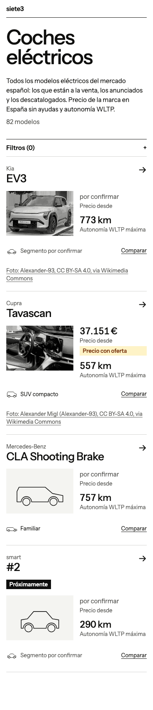
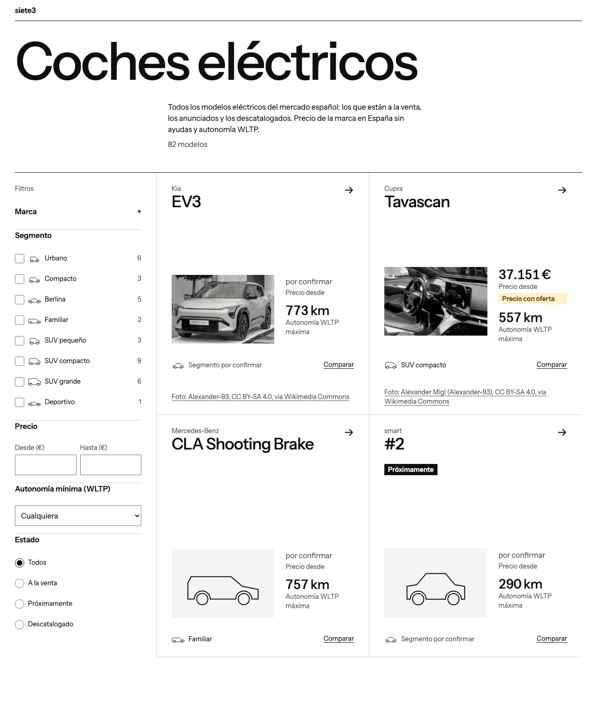
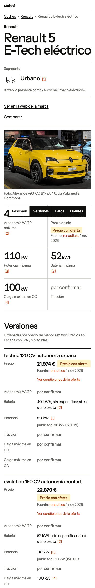
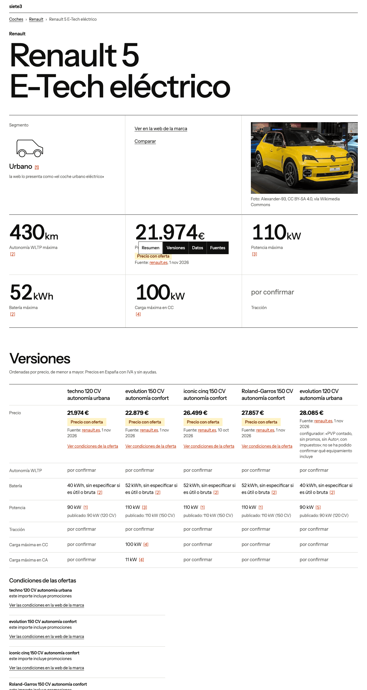

# Propuesta C · «Retícula»: manda la composición

Fuente: **Instrument Sans**. Prototipos: `web/design-proto/catalogo-c.astro` y `ficha-c.astro`.

**Idea.** La página es una retícula de celdas separadas por líneas finas, sin sombras ni esquinas redondas, con un titular
enorme y mucho blanco. Cada celda repite el mismo patrón: nombre, hueco fijo de 3:2, cifras apiladas y segmento. La silueta
de segmento está en **todas** las celdas y en el filtro, no solo cuando falta la foto. El menú inferior (RF-17) es una regleta
de celdas rectas, un trozo de la retícula que flota. Las cifras clave (RF-18) son celdas: número, unidad pequeña y etiqueta.

**Fotos malas.** El coche va pequeño y siempre en el mismo hueco. En el catálogo las fotos pasan a **blanco y negro**
(`grayscale` y `multiply` sobre `surface-muted`), lo que iguala fondos y encuadres: hasta la de Tavascan, que es del
interior, se integra. Sin foto, la silueta ocupa el mismo hueco con trazo fino y parece hecha a propósito. En la ficha la
foto va en color, en una celda de un tercio: no se amplía lo que no aguanta. Cuando lleguen fotos mejores, basta con quitar
el filtro y ampliar el hueco.

**Dato ausente.** «por confirmar» conserva la celda y la etiqueta, en `ink-600` y a menor tamaño: la retícula no se rompe.

| | Móvil | Escritorio |
|---|---|---|
| Catálogo |  |  |
| Ficha |  |  |

La regleta sale a media captura porque es fija; en pantalla va al pie de la ventana. Las capturas se cortan a 2400 px.

## Tokens que cambian y contraste (calculado a mano, WCAG 2.1)

| Token | Valor | Par | Ratio |
|---|---|---|---|
| `--color-ink-900` y `soon-bg` | `#0f0f0e` | sobre `surface` / `surface-muted` | 19,18 / 17,40 |
| `--color-ink-600` | `#5c5c57` | sobre `surface` / `surface-muted` | 6,72 / 6,10 |
| `--color-brand-600` | `#c2340a` | sobre `surface` / `surface-muted`; `on-brand` encima | 5,63 / 5,11; 5,63 |
| `--color-brand-800` | `#8f2406` | sobre `surface` / `surface-muted` | 8,66 / 7,86 |
| `--color-line` | `#77776f` | borde de control sobre `surface` / `surface-muted` | 4,51 / 4,09 (≥ 3) |
| `--color-line-soft` | `#d4d4ce` | línea de celda, decorativa | 1,49 (no se exige) |
| `--color-surface-muted` | `#f4f4f1` | fondo del hueco | — |
| Regleta | `surface` sobre `ink-900`; actual, al revés | texto y anillo de foco | 19,18 |

`deal` no cambia (8,15). Nuevos: `--radius-card: 0`, `--text-display` (`clamp(3rem, 1.5rem + 7.2vw, 7rem)`),
`--text-key-figure` (`clamp(2.5rem, 1.5rem + 4vw, 4.5rem)`), `--text-cell-title`, `--text-figure`,
`--tracking-tight: -0.035em`. Ningún texto baja de 14 px.

## Textos nuevos (RNF-4)

`ficha.menu.nombre` «Secciones de la ficha», `ficha.menu.resumen` «Resumen», `ficha.menu.datos` «Datos»,
`ficha.cifra.potencia` «Potencia máxima», `ficha.cifra.bateria` «Batería máxima». Lo demás ya está en `i18n.ts`.

## Lo que se pierde

- **El color del coche en el catálogo:** se ve al entrar en la ficha. Es lo más discutible: el R5 amarillo pierde gracia.
- **El impacto de la imagen:** es la propuesta menos espectacular, y el coche no protagoniza nada.
- **Densidad:** con tanto aire caben menos modelos por pantalla; en escritorio, dos por fila junto a los filtros.
- **Una silueta grande sin segmento:** la genérica se repite si faltan muchos segmentos (hoy faltan bastantes).
